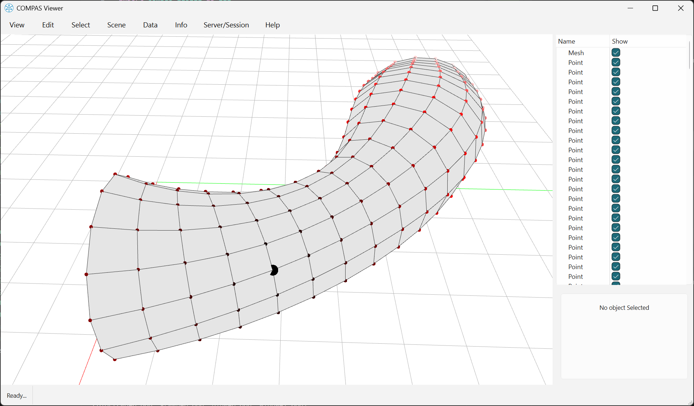
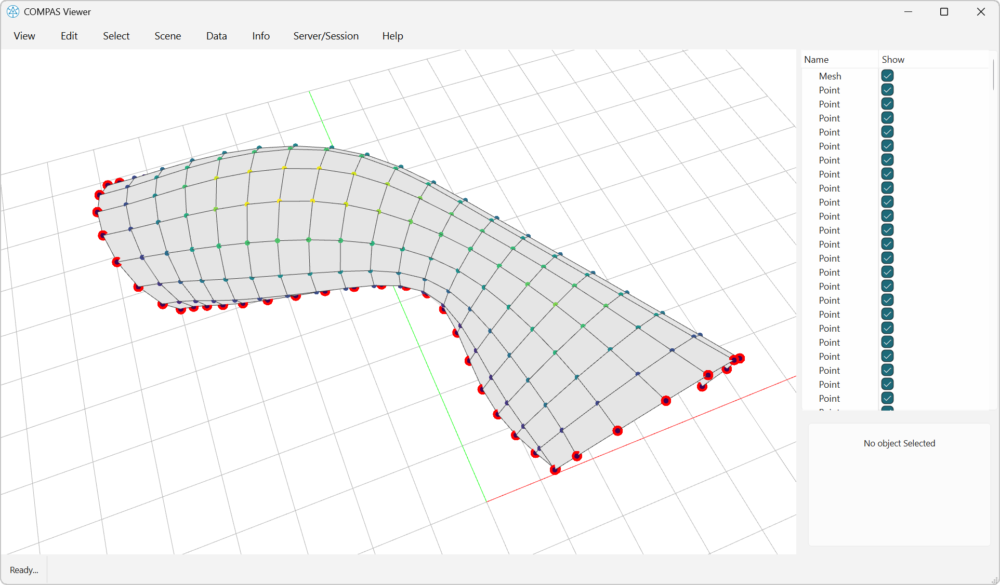

# Geodesic distance

This visual example requires the compiled `compas_libigl` extensions and `compas-viewer`.



```python
--8<-- "docs/examples/example_geodistance.py"
```



```python
--8<-- "docs/examples/example_geodistance_multiple.py"
```


