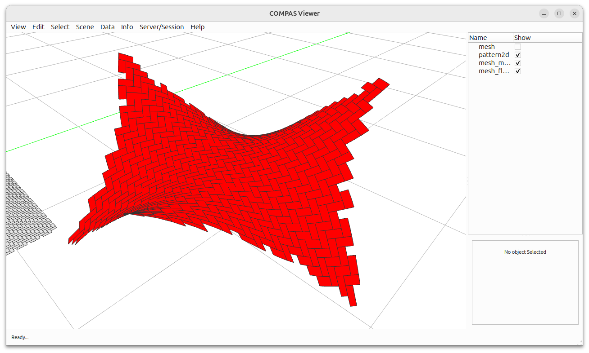
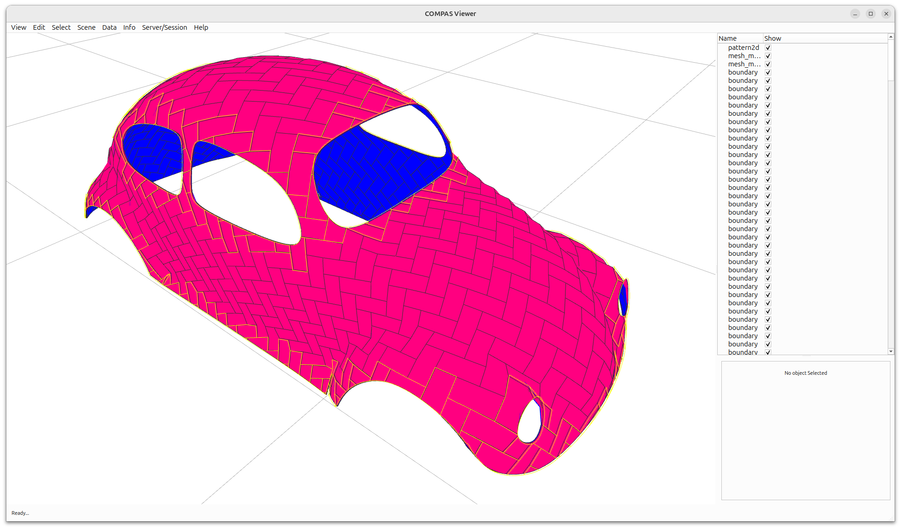

# Mapping

This visual example requires the compiled `compas_libigl` extensions and `compas-viewer`.



```python
--8<-- "docs/examples/example_mapping_patterns.py"
```



```python
--8<-- "docs/examples/example_mapping.py"
```


