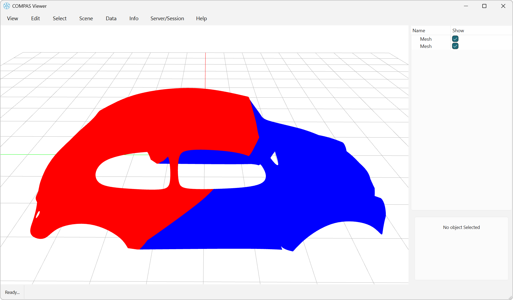
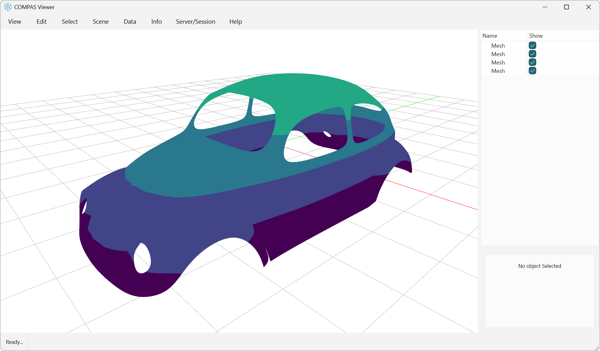
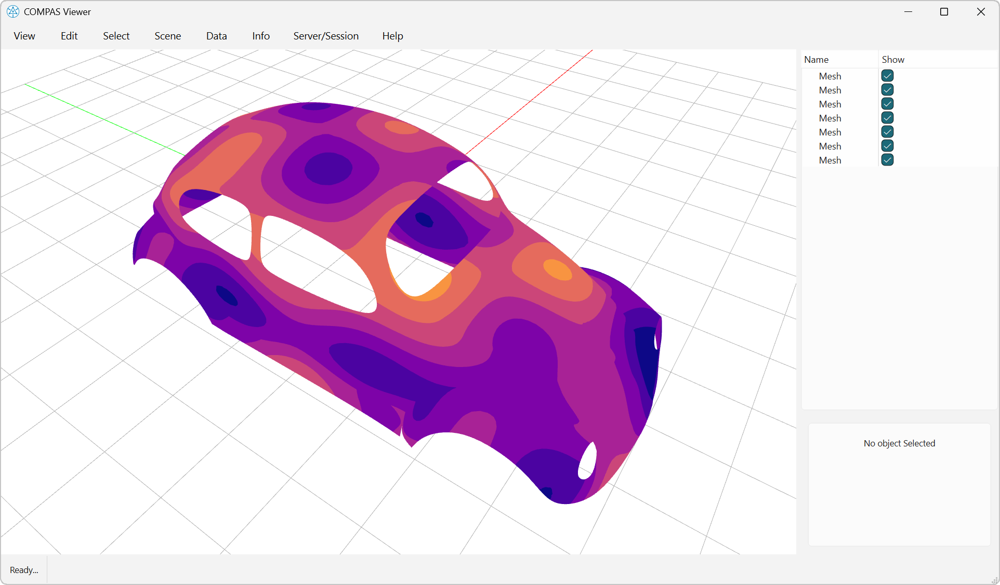
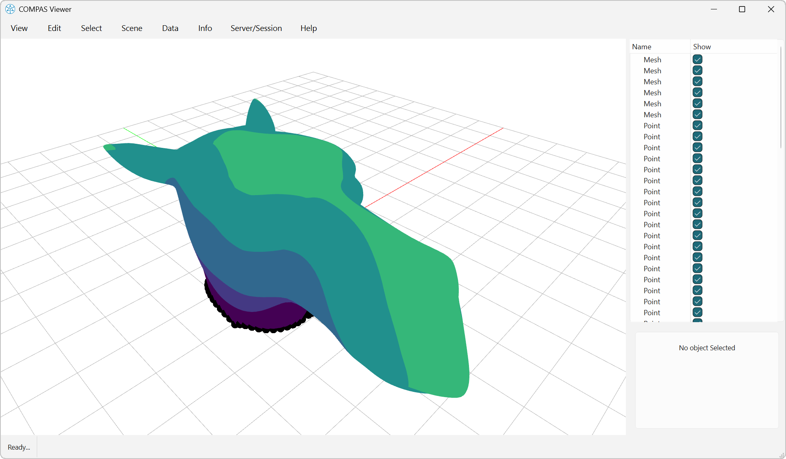

# Meshing

This visual example requires the compiled `compas_libigl` extensions and `compas-viewer`.



```python
--8<-- "docs/examples/example_meshing_plane.py"
```



```python
--8<-- "docs/examples/example_meshing_planes.py"
```



```python
--8<-- "docs/examples/example_meshing_waves.py"
```



```python
--8<-- "docs/examples/example_meshing_geodesic.py"
```


