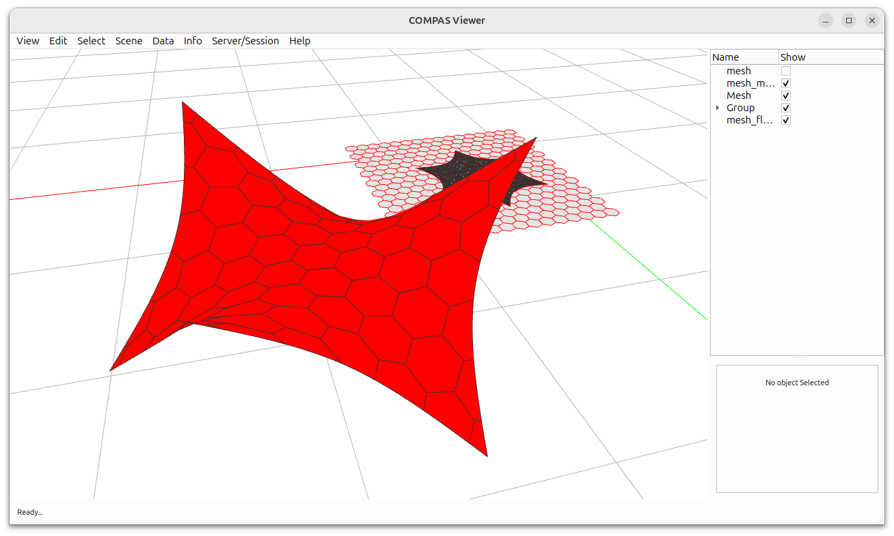

# COMPAS libigl

COMPAS libigl provides selected algorithms from [libigl](https://libigl.github.io/) as Python bindings for COMPAS. The native extensions are generated with [nanobind](https://nanobind.readthedocs.io/).

The package includes geodesic distance, isolines, mesh parametrisation, mass matrices, curvature, ray intersections, boundary loops, planarisation, mapping, simplification, and related mesh-processing operations.

Start with [installation](installation.md), then see the [tutorial](tutorial.md), [examples](examples.md), or [API reference](api.md).

!!! note
    COMPAS libigl owns and builds its native libigl bindings. Install this package explicitly when using these algorithms; installing core COMPAS alone does not install the native extension.
